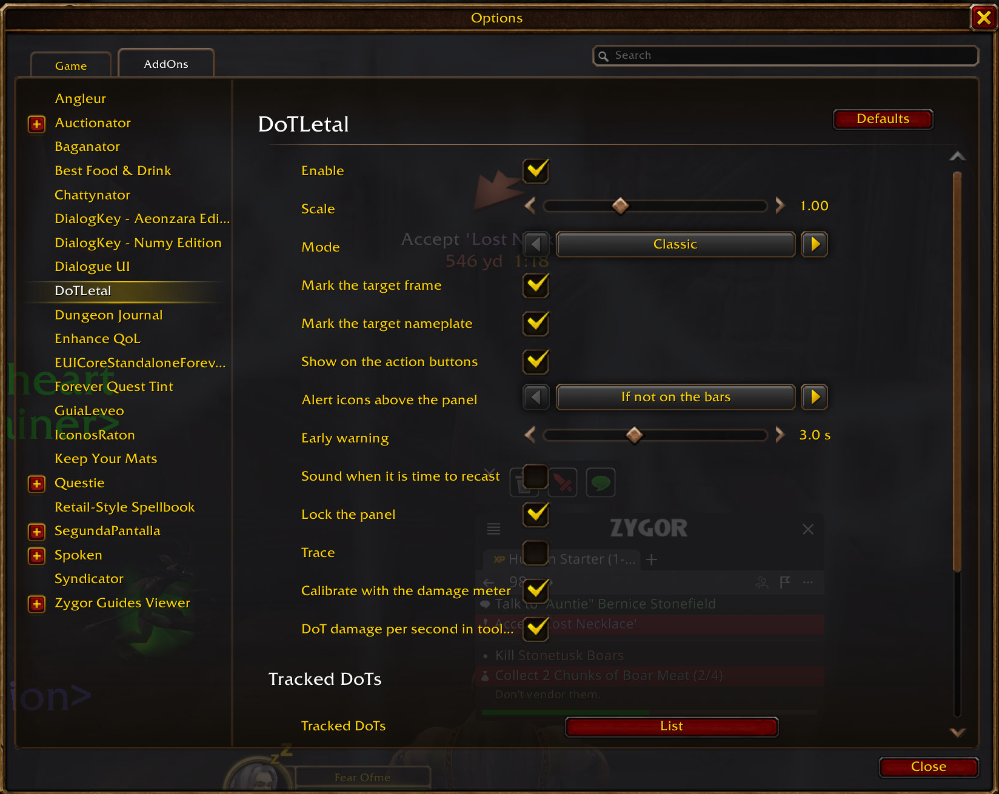

# DoTLetal

Addon para World of Warcraft **retail** (Midnight, 12.1) y **Forever**. Mientras tus DoTs hacen daño:

- **En la barra de vida del objetivo** (marco de objetivo, su placa y el panel del addon) pinta en
  naranja el trozo de vida que se llevarán tus DoTs. Lo mismo en el **marco de foco** y en la **placa de cada
  enemigo** con DoTs tuyos, aunque no sea tu objetivo.
- Pone una **calavera** a la izquierda de esa barra si tus DoTs bastan para matarlo.
- Un **panel** dice cuánto daño por segundo le hacen tus DoTs y cuánto les queda en total, y debajo,
  uno por línea, cada DoT con los segundos que le quedan y su daño por segundo.
- **Te avisa de cuándo relanzar cada DoT** para no dejarlo caer ni recortarlo, **encima de su botón en las
  barras de acción**: un marco de color y un texto. Ámbar con cuenta atrás (3 s de serie, ajustable de 1 a 6 s en «Aviso previo»): prepárate, aún no (relanzarlo
  ahora perdería ticks). Verde «¡YA!»: lánzalo ahora. Rojo «CAÍDO»: se ha caído y sigues con ese objetivo (se
  avisa 8 s). Si un DoT no está en ninguna barra visible, el aviso sale en un icono grande encima del panel
  (la opción permite también «siempre» o «nunca»). Las filas del panel toman el mismo color, y hay un sonido
  opcional (apagado de serie). Funciona con las barras de Blizzard; las de Bartender, ElvUI o Dominos aún no.
  - **Forever**: reaplicar sustituye al DoT entero (sin pandemia de duración; allí «Pandemia» es un talento de
    críticos) y vuelve a empezar los ticks. Si el nuevo llega antes del último tick del viejo, ese tick se
    pierde; si llega un poco tarde, solo se pierde ese rato. Por eso «¡YA!» se enciende cuando quedan los
    segundos que tarda en lanzarse (Corrupción e Inmolar sin talentos: 2 s; Maldición de agonía: al caer),
    con un margen de 0,1 s, para que el nuevo llegue justo después del último tick.
  - **Retail**: «¡YA!» se enciende cuando el nuevo llegaría dentro del 30 % final (pandemia), que no pierde nada.
  - El tiempo de lanzamiento sale de `C_Spell.GetSpellInfo` (ya con talentos como Corrupción mejorada). Si el
    DoT no entró (resistido, inmune, disipado), el addon no lo sabe y avisará igual.

## Cómo lo sabe (y por qué no hace la cuenta él)

Desde Midnight la vida de los enemigos es un **valor secreto**: un addon no puede compararla ni
restarla. DoTLetal no lo hace; le entrega la vida al juego:

- **Pérdida**: una barra naranja anclada al final del relleno de la barra de vida, con el mismo
  máximo y el daño de los DoTs como valor. Blizzard pinta así su predicción de curación.
- **Calavera**: si la vida máxima del objetivo es legible, una curva escalonada sobre el porcentaje de
  vida la muestra solo por debajo del daño de los DoTs. Si también es secreta, la decide una barra
  invisible con rango [daño, daño + 1] que el juego recorta.

El daño de los DoTs sí lo calcula el addon, con su propio reloj, porque en combate las auras del
objetivo también son secretas:

1. Al terminar de lanzar un DoT, apunta la hora. **Trae todos los DoTs del juego**, sacados de las tablas
   del propio cliente (`Datos/Retail.lua`, 116 hechizos, y `Datos/Forever.lua`, 231 con todos sus rangos):
   su periodo de tick, si la celeridad lo acelera y a qué talentos responde. No hay que añadir nada.
2. Lee el daño total y la duración en la descripción del hechizo, que ya incluye tu poder con hechizos y
   los talentos que cambian el daño o la duración.
3. **Detecta solo** los talentos que tienes que cambian el ritmo de los ticks (por ejemplo, Creeping Death,
   −10 % sobre Corrupción, Agonía y Aflicción inestable) y los recalcula al cambiar talentos o especialización.
4. En retail aplica tu celeridad a los DoTs que el juego marca así (los ticks van más rápido y hacen más daño
   en total) y la pandemia: reaplicar conserva hasta el 30 % de la duración. La Agonía sube de escalón en
   cada tick. En Forever, como en Vanilla, la celeridad no acelera los DoTs.
5. **Se calibra con el daño real.** En combate no se puede leer el daño de tus DoTs: el registro de combate está
   cerrado y el medidor de daño de Blizzard es secreto. Al salir de combate sí: DoTLetal compara el daño real de
   cada DoT en el medidor con lo que había estimado y guarda un factor por hechizo y personaje, que aplica en los
   combates siguientes. Así recoge críticos, maestría y lo demás que la descripción no dice. Solo aprende de
   combates contra un único objetivo, con al menos 3 ticks del DoT, y no de los hechizos con golpe directo (el
   medidor los suma). Necesita el medidor de daño activado en las opciones del juego. Con el **modo prudente**,
   la calibración solo puede bajar el daño previsto: no cuenta con críticos que aún no han salido.
6. **Se da cuenta de los fallos.** Si el resultado del ataque sobre el enemigo justo al lanzarlo es un fallo,
   resistido o inmune (o esquivado o parado, en un sangrado), el DoT no cuenta y sale «CAÍDO». Si no avisa, pero
   pasan dos ticks sin que llegue ningún golpe a su hora, también se quita.
7. **Sabe a quién iba cada DoT**: lo apunta al pulsar el hechizo, así que cambiar de objetivo justo después, una
   macro al foco o lanzar al ratón no lo ponen en otro enemigo. Al cambiar de objetivo no se olvida: con la
   identidad del PNJ oculta (mazmorras), sigue a cada enemigo por su placa.

   Las ideas de los puntos 6 y 7 y de las placas vienen de [Does It Die](https://github.com/swirllyman/DoesItDie)
   (Joe Greive, licencia MIT); el código es propio.

## Uso

- `/dotletal mover` desbloquea el panel (se ve con datos de muestra) para arrastrarlo; repítelo para
  bloquearlo.
- `/dotletal lista` enseña tus DoTs y sus segundos entre ticks con tus talentos.
- `/dotletal` o el botón del compartimento de addons abre las opciones (Opciones > AddOns > DoTLetal), con todo
  lo de los comandos: activar, escala, modo (Clásico con la lista o Compacto con solo los totales), marcar el
  marco de objetivo, las placas y el foco, modo prudente, bloquear el panel, traza, ver tus DoTs, diagnóstico y
  restablecer (con
  confirmación).
- `/dotletal calibracion` enseña el factor aprendido de cada DoT; `/dotletal calibracion borrar` lo olvida.
- `/dotletal traza` activa mensajes de depuración (por ejemplo, si no entiende la descripción de un DoT).
- `/dotletal debug` saca el diagnóstico para informar de un problema.

Los datos se regeneran tras cada parche con `python tools/generar_datos.py`, que baja las tablas del cliente
de wago.tools (SpellEffect, SkillLineAbility, SpecializationSpells, TraitDefinition, Talent, SpellClassOptions,
SpellMisc, SpellDuration) para el build de retail y el de Forever que tiene apuntados. Un DoT es un hechizo que
el jugador puede aprender con un efecto de daño periódico sobre otro; quedan fuera los pasivos y los canalizados
(se cortan y el addon no puede saberlo).

## Límites (conviene saberlos)

- **Solo cuenta tus DoTs.** El daño de otros jugadores no entra; si te ayudan, morirá antes.
- **Los fallos se deducen, no se leen.** El juego no dice de qué ataque es cada resultado: si en el mismo
  instante falla un golpe de tu mascota o de otro jugador, puede quitar un DoT que sí entró (el error es por lo
  bajo, nunca anuncia una muerte que no llega). Y un DoT resistido sobre un enemigo fuera de la vista (sin placa,
  sin ser objetivo ni foco) sigue contando hasta que vuelves a verlo.
- **Al cambiar de objetivo puede olvidarlo** si el juego oculta la identidad del PNJ y ese enemigo no tiene
  placa visible: entonces solo sigue al objetivo actual.
- **Es una estimación.** Críticos, maestría y otros modificadores que la descripción no recoge entran con la
  calibración, como media de los últimos combates: un combate con suerte o sin ella se sale de la media. Quedan
  fuera los efectos de conjunto de equipo que cambian el ritmo y los DoTs que dependen de los puntos de combo
  (Destripar, Ruptura). La celeridad, si en combate es secreta, se toma de la última lectura.
- Las placas se marcan con las de Blizzard y con Plater, y el foco con el marco de Blizzard; otras placas o
  marcos de unidad, no.

## Informar de un problema

Abre un issue con el texto de `/dotletal debug` y, si hay error, la exportación de BugSack.

## Desarrollo

Proyecto creado con la plantilla de la skill `wow-addons`. Comprobaciones fuera del juego (luacheck,
StyLua, LuaLS, API real de Forever, tests en Lua 5.1 y XML):

```powershell
C:\Users\Nico\.claude\skills\wow-addons\scripts\verificar-addon.ps1 -Carpeta .
```

Tests solos: `python tools/probar_addon.py . --ambos`. Estado y pendientes en [PLAN.md](PLAN.md).

## Capturas


